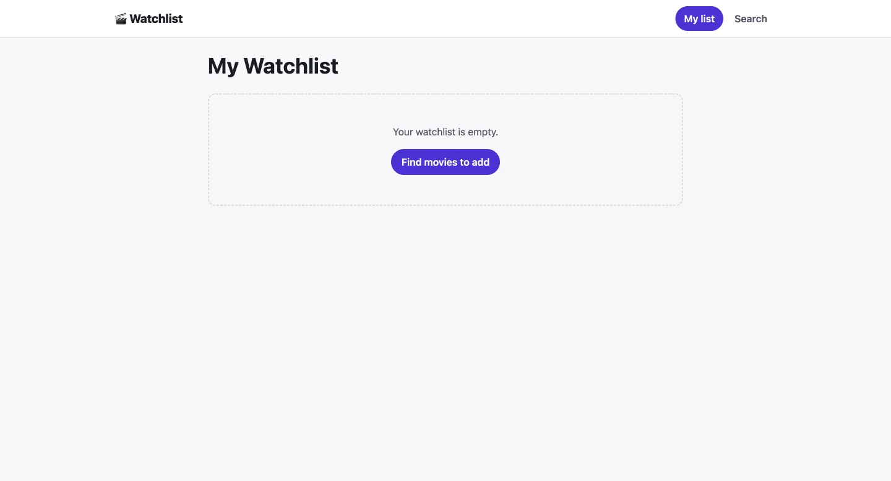
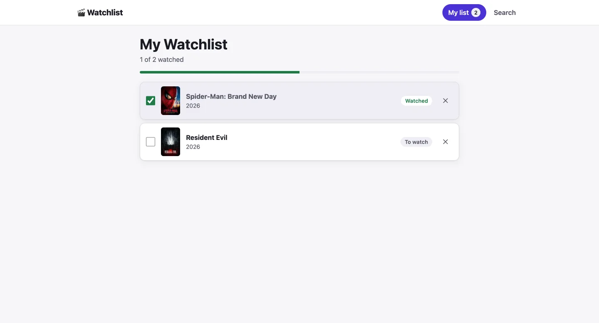
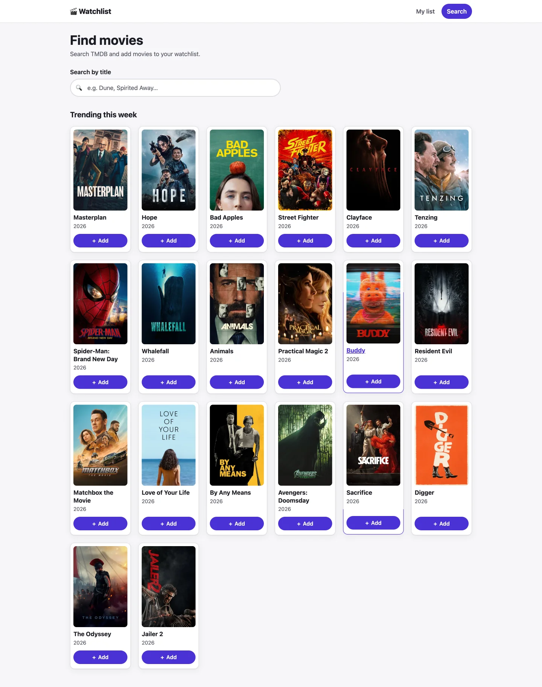
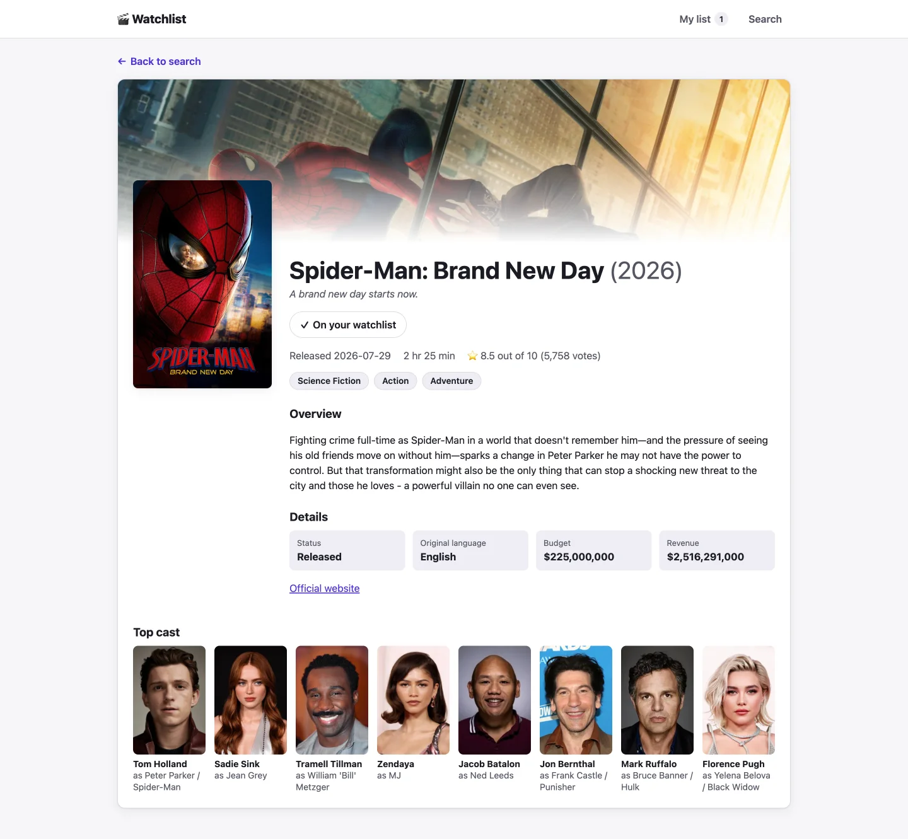

# TMDB Watchlist (Angular 22)

A small movie watchlist app built on [The Movie Database (TMDB) API](https://developer.themoviedb.org/). It's a portfolio project to show modern Angular patterns, and it's still being built in phases (see [Roadmap](#roadmap)).

## Features

- **Watchlist**: add movies, check them off as watched, and remove them. A progress bar and a "2 of 3 watched" summary are computed from the list. The list is saved to `localStorage`, so it survives a page reload.
- **Search**: live search of TMDB as you type (debounced). When the box is empty, it shows this week's trending movies. Add or remove any result with one click.
- **Movie details**: poster, backdrop, tagline, runtime, rating, genres, budget/revenue, original language, and the top-billed cast. TMDB's `append_to_response` returns the credits in the same request as the details.
- **Navigation**: a sticky header with the current page highlighted and a badge showing how many movies are on your list.
- **Theming**: CSS custom-property design tokens with automatic light and dark mode.

## Screenshots

### Watchlist

| Empty | With movies |
| --- | --- |
|  |  |

### Search



### Movie details



## Angular concepts used

| Concept | Where |
| --- | --- |
| Standalone components (no NgModules) | All components |
| Signal-based store service: private writable `signal`, public `asReadonly()`, `computed`, `effect` for persistence | [watchlist-store.ts](src/app/watchlist-store.ts) |
| RxJS ↔ signals with `toSignal` | [search.ts](src/app/search/search.ts), [movie-detail.ts](src/app/movie-detail/movie-detail.ts) |
| Reactive forms + `debounceTime` / `distinctUntilChanged` / `switchMap` typeahead | [search.ts](src/app/search/search.ts) |
| Route params → HTTP with `switchMap` (cancels stale requests) | [movie-detail.ts](src/app/movie-detail/movie-detail.ts) |
| Lazy-loaded routes via `loadComponent`, route `title`s | [app.routes.ts](src/app/app.routes.ts) |
| Built-in control flow (`@if`, `@for`, `@else`) | All templates |
| `inject()` function-based DI | Components and services |
| Typed `HttpClient` service, `providedIn: 'root'` | [movie.service.ts](src/app/movie.service.ts) |
| Built-in pipes (`number`, `currency`) | [movie-detail.html](src/app/movie-detail/movie-detail.html) |
| Loading / error / empty states | [search.html](src/app/search/search.html), [movie-detail.html](src/app/movie-detail/movie-detail.html) |
| Unit tests with Vitest: mocked services, fake timers for debounce, and automated axe-core accessibility checks | `*.spec.ts` next to each component |

## Accessibility

Accessibility is checked automatically. Every page's spec runs [axe-core](https://github.com/dequelabs/axe-core) through [src/testing/axe.ts](src/testing/axe.ts), and the test fails on any violation. The pages were also audited with axe in a real Chrome browser, where color contrast can be measured, in both light and dark mode.

- **Skip link and landmarks**: a "Skip to main content" link, a labelled `<nav>`, and a single `<main>`. The active nav link has `aria-current="page"`.
- **Page titles**: each route sets a document title, and the movie details page uses the movie's name.
- **Watchlist**: each row has a native `<input type="checkbox">` labelled with the movie title, so keyboard and screen reader support come for free. The title is a separate link to the details page. Clicking blank space on a row also toggles it, as a mouse shortcut. Removing a movie is announced through a polite live region.
- **Search**: the input has a visible `<label>` and sits in a `role="search"` form. A live region announces the number of results. The Add/Remove buttons include the movie title in their accessible name, such as "Add Dune to watchlist", while the visible text stays short.
- **Movie details**: an `article` with labelled `section`s and a proper heading order (`h1` → `h2`). Facts use lists, and details use a description list (`dl`).
- **Images**: posters on the details page have descriptive `alt` text. Thumbnails sit next to the title link, so they're decorative and have `alt=""`.
- **Announcements**: decorative emoji are hidden from assistive tech. Loading uses `role="status"` and errors use `role="alert"`.
- **Focus, contrast and motion**: a visible `:focus-visible` outline on every interactive element. The color tokens meet WCAG AA contrast in both themes. Animations are turned off for users with `prefers-reduced-motion`.

## Getting started

**Prerequisites:** Node.js 22.22+, 24.15+, or 26+ and a free [TMDB API key](https://www.themoviedb.org/settings/api).

```bash
npm install
```

The development API key file is git-ignored, so you need to create it yourself at `src/environments/environment.development.ts`:

```ts
export const environment = { tmdb: 'YOUR_TMDB_API_KEY' };
```

Then:

```bash
npm start        # dev server at http://localhost:4200
npm test         # unit tests (Vitest)
npm run build    # production build to dist/
```

## Project structure

```
src/app/
├── app.routes.ts        # lazy-loaded routes with page titles
├── movie.service.ts     # TMDB HTTP calls
├── watchlist-store.ts   # signal-based watchlist state, persisted to localStorage
├── movie.ts             # domain + TMDB API types
├── watchlist/           # your list: toggle watched, remove
├── search/              # live search + trending grid
└── movie-detail/        # full details for one movie (/movie/:id)
src/testing/axe.ts       # shared axe-core accessibility assertion for specs
```

## Roadmap

This project is being built in phases:

- [x] **Phase 1**: Watchlist with signals, routing, TMDB trending, and movie details
- [x] **Next phases**: remaining features in progress

## Notes

- The TMDB key is used in the browser. That's fine for a demo, but a production app would send requests through a backend so the key stays private.
- This product uses the TMDB API but is not endorsed or certified by TMDB.
